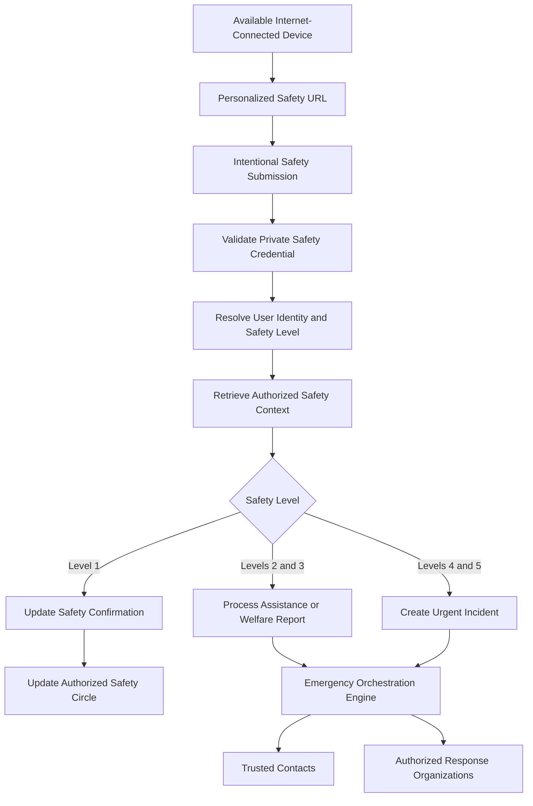
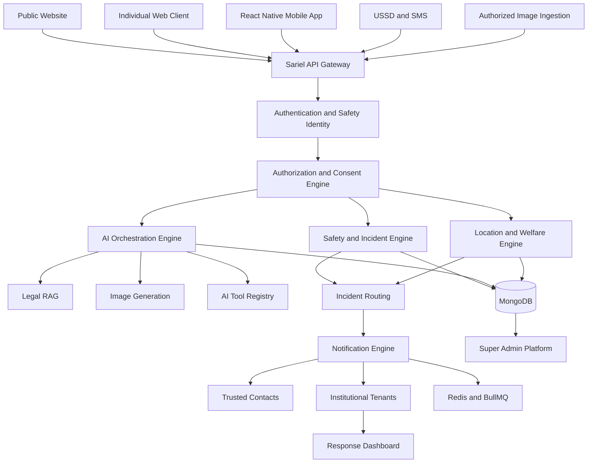
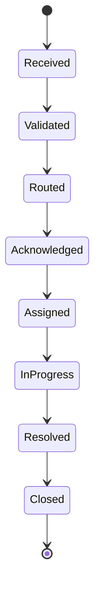

# SARIEL

### A Voice When You Have None.

**AI-Powered Personal Safety, Security and Assistance Platform**


---

> When someone cannot openly ask for help, technology should provide another way to reach it.

**Website:** [sariel.app](https://sariel.app) (proposed platform domain)

**Hackathon:** [TechSavanna Hack 1.0](https://hackathon.techsavanna.technology/)

**Primary focus:** Social Impact

**Secondary alignment:** Cybersecurity & Digital Trust

---

## Table of Contents

- [Overview](#overview)
- [The Meaning Behind Sariel](#the-meaning-behind-sariel)
- [Hackathon](#hackathon)
- [The Problem](#the-problem)
- [Our Solution](#our-solution)
- [Core Features](#core-features)
- [Safety Identity](#safety-identity)
- [Use Cases](#use-cases)
- [Platform Architecture](#platform-architecture)
- [Multi-Tenant Response Platform](#multi-tenant-response-platform)
- [Technology Stack](#technology-stack)
- [Project Structure](#project-structure)
- [Getting Started](#getting-started)
- [Development Roadmap](#development-roadmap)
- [Security and Privacy](#security-and-privacy)
- [Constitutional Foundation](#constitutional-foundation)
- [Sustainable Development Goals](#sustainable-development-goals)
- [Expected Social Impact](#expected-social-impact)
- [Limitations](#limitations)
- [Contributing](#contributing)
- [References](#references)

## Overview

Sariel is an AI-powered personal safety, security and assistance platform designed to empower individuals, protect vulnerable communities, strengthen family connectivity and facilitate coordinated emergency assistance.

The project is inspired by the challenges experienced by Kenyan migrant workers facing exploitation abroad, individuals recruited through fraudulent employment opportunities, victims of human trafficking, survivors of gender-based violence and people who lose access to conventional communication channels.

Sariel introduces multiple ways for individuals to communicate their safety status, report emergencies and seek assistance without depending entirely on a personal smartphone, installed application or reliable internet connection.

Through personalized safety identities, emergency URLs, USSD, SMS, encrypted image steganography, authorized location sharing and intelligent welfare monitoring, Sariel seeks to provide additional communication options when individuals are unable to openly request help.

Beyond personal security, Sariel functions as an intelligent everyday assistant capable of understanding natural-language commands and performing supported, authorized actions.

**Our mission is to make personal safety, intelligent assistance and access to help more accessible, regardless of geographical location, device availability or communication constraints.**

## The Meaning Behind Sariel

The name **Sariel** is inspired by an angelic figure appearing in ancient religious traditions.

We chose this name because its symbolic associations with divine authority, guidance and oversight reflect our vision of an intelligent digital guardian.

For us, Sariel represents:

- **Protection:** Helping individuals communicate distress and access assistance.
- **Guidance:** Empowering users with reliable information and intelligent support.
- **Hope:** Creating alternative communication options during difficult circumstances.
- **Connection:** Keeping individuals connected with their loved ones.
- **Empowerment:** Giving individuals greater control over their personal safety.

Sariel represents more than an artificial intelligence assistant. It embodies the idea of technology serving humanity, particularly when individuals are vulnerable, isolated or unable to speak freely.

Our tagline captures this purpose:

### A Voice When You Have None.

## Hackathon

Sariel is being developed for **TechSavanna Hack 1.0**, a technology hackathon bringing together developers, designers, engineers, data scientists and innovators to address real-world challenges.

| Event                     | Details                                                   |
| ------------------------- | --------------------------------------------------------- |
| Hackathon                 | TechSavanna Hack 1.0                                      |
| Theme                     | AI for Health: Building Technology That Watches Over Life |
| Dates                     | November 26–28, 2026                                      |
| Location                  | Reliance Center, Westlands, Nairobi, Kenya                |
| Proposed submission track | Social Impact                                             |
| Complementary focus       | Cybersecurity & Digital Trust                             |
| Project                   | Sariel                                                    |
| Tagline                   | A Voice When You Have None.                               |

Sariel aligns with the hackathon's objective of developing practical, human-centred technology that addresses local challenges and creates meaningful social impact.

The project applies artificial intelligence, secure communication, mobile technology and institutional coordination to improve personal safety, welfare monitoring and access to assistance.

[Visit the official hackathon website](https://hackathon.techsavanna.technology/).

## The Problem

Millions of individuals worldwide experience violence, exploitation, forced labour and human trafficking. For many, seeking assistance is particularly difficult because their movement, personal devices and communication channels are controlled.

### Global Gender-Based Violence

According to the World Health Organization's 2025 report:

- Nearly **1 in 3 women globally** has experienced intimate partner violence or non-partner sexual violence during her lifetime.
- Approximately **840 million women** have experienced these forms of violence.
- Approximately **316 million women** experienced physical or sexual violence from an intimate partner within the preceding year.
- Only **0.2% of global development aid** was allocated to programmes preventing violence against women in 2022.

Abusers may restrict access to communication devices, monitor messages and isolate individuals from their support networks.

Source: [World Health Organization, 2025](https://www.who.int/news/item/19-11-2025-lifetime-toll--840-million-women-faced-partner-or-sexual-violence).

### Gender-Based Violence in Kenya

The Kenya Demographic and Health Survey 2022 reported that:

- **34% of Kenyan women aged 15–49** have experienced physical violence since the age of 15.
- **13% of Kenyan women aged 15–49** have experienced sexual violence.
- **42% of women who experienced physical or sexual violence** neither sought help nor disclosed their experiences to anyone.

These findings highlight the need for accessible, privacy-conscious communication and assistance mechanisms.

Source: [Kenya National Bureau of Statistics — KDHS 2022](https://www.knbs.or.ke/reports/kdhs-2022/).

### Exploitation of Kenyan Workers in the Middle East

- More than **150,000 Kenyan domestic workers** are estimated to reside in Saudi Arabia, most of whom are women.
- Amnesty International interviewed **72 Kenyan women** for its 2025 investigation documenting abusive and exploitative employment conditions.
- More than **500,000 Kenyans** were reported to be living, working or studying in the Middle East as of March 2026.

Documented challenges include passport confiscation, restricted movement, excessive working hours, discrimination, forced labour and physical or sexual abuse.

The migrant population figures represent the scale of the population, not the number of confirmed abuse victims.

Sources: [Amnesty International, 2025](https://www.amnesty.org/en/documents/mde23/9222/2025/en/) and [The Star, March 2026](https://www.the-star.co.ke/news/2026-03-09-mudavadi-were-focused-on-safety-of-kenyans-in-middle-east).

### Human Trafficking in Southeast Asia

- Approximately **400 Kenyans** were reportedly deceived through fraudulent employment opportunities in Asia, including Vietnam, Cambodia and Myanmar, according to a November 2025 government briefing.
- More than **1,200 trafficking victims** were reportedly rescued and repatriated from scam compounds in Myanmar, Laos and Cambodia through the Kenyan Embassy in Bangkok, as reported in November 2026.

Some victims are recruited through seemingly legitimate employment opportunities and subsequently forced to participate in online scams and other criminal activities.

Although victims may have access to workplace computers, their communications may be monitored and their personal devices confiscated.

Sources: [The Standard, November 2025](https://standardmedia.co.ke/business/amp/national/article/2001534043/mudavadi-400-kenyans-fall-victim-to-fraudulent-jobs-in-asia) and [State Department for Diaspora Affairs, November 2026](https://www.diaspora.go.ke/news-details.php?nid=265).

### Recruitment of Kenyans into Russian Military Operations

- More than **1,000 Kenyans** were estimated to have been recruited into Russian military operations, according to an intelligence report presented to Parliament in February 2026.
- **291 Kenyans** had been officially identified as recruited by May 7, 2026.
- **28 Kenyans** were reported missing in action as of February 2026.

The estimated and officially identified recruitment figures represent different reporting approaches and should not be directly interpreted as a change in the total number recruited.

Additionally, the State Department for Diaspora Affairs reported facilitating the repatriation of the remains of more than **165 deceased Kenyans during 2025**, covering diaspora assistance generally.

Sources: [Reuters, February 2026](https://www.reuters.com/world/africa/over-1000-kenyans-recruited-fight-russia-ukraine-report-says-2026-02-19/), [Citizen Digital, May 2026](https://citizen.digital/article/number-of-kenyans-recruited-in-russian-army-rises-to-291-as-19-die-in-battlefield-n382230) and [State Department for Diaspora Affairs](https://diaspora.go.ke/news-details.php?nid=209).

### The Common Challenge

Despite their different circumstances, vulnerable individuals frequently experience similar barriers.

| Challenge                    | Consequence                                                   |
| ---------------------------- | ------------------------------------------------------------- |
| Monitored communications     | Individuals may be unable to openly request help.             |
| Confiscated personal devices | Conventional mobile applications become inaccessible.         |
| Restricted movement          | Individuals cannot physically access support services.        |
| Limited connectivity         | Internet-dependent communication becomes unreliable.          |
| Geographical isolation       | Families struggle to establish their loved ones' whereabouts. |
| Lack of legal knowledge      | Individuals may not understand their rights.                  |
| Fraudulent recruitment       | Job seekers unknowingly enter exploitative environments.      |
| Fear of retaliation          | Survivors may avoid reporting abuse.                          |
| Fragmented reporting systems | Responders may receive incomplete information.                |

**The problem is not always the absence of assistance. Sometimes, it is the inability to reach it.**

## Our Solution

Sariel introduces an integrated personal safety ecosystem built around six fundamental pillars.

| Pillar      | Purpose                                                        |
| ----------- | -------------------------------------------------------------- |
| **PREVENT** | Safe recruitment, migration preparation and safety awareness.  |
| **ASSIST**  | Intelligent everyday assistance and authorized task execution. |
| **PROTECT** | Emergency communication and alternative distress reporting.    |
| **CONNECT** | Family connectivity and trusted support networks.              |
| **EMPOWER** | Constitutional, legal and humanitarian information.            |
| **RESPOND** | Coordinated incident management and institutional assistance.  |

Rather than relying on a single emergency reporting mechanism, Sariel provides several communication channels connected to one centralized safety engine.

These include:

- Personalized safety URLs.
- Web-based emergency reporting.
- USSD and SMS.
- AI-powered encrypted image communication.
- Mobile SOS.
- Trusted-contact welfare reports.
- Automatic inactivity monitoring.

The platform is designed to operate before danger occurs, during emergencies, when communication is lost and throughout the response process.

## Core Features

### Sariel Identity — Universal Safety Identity

Every registered individual receives a unique account username and can generate private safety credentials.

These credentials enable individuals to communicate their safety status from an available internet-connected device without signing into their ordinary account or installing the mobile application.

Features include:

- Unique username registration.
- Private safety credential generation.
- Safety credential regeneration and revocation.
- Personal emergency profiles.
- Authorized emergency information retrieval.
- Multi-channel identity resolution.

### Sariel Guardian — Emergency Assistance

A centralized personal safety and emergency reporting system.

Features include:

- Manual SOS activation.
- Emergency severity classification.
- Text-based emergency reporting.
- Future voice-based emergency activation.
- Authorized contextual information collection.
- Emergency incident creation.
- Trusted-contact notifications.
- Incident status tracking.
- Institutional response coordination.

### Sariel Connect — Multi-Channel Communication

Provides multiple communication options for individuals experiencing different device and connectivity limitations.

| Channel            | Purpose                                                            |
| ------------------ | ------------------------------------------------------------------ |
| Safety URLs        | Application-independent emergency reporting.                       |
| Web client         | Complete browser-based safety platform.                            |
| USSD               | Emergency reporting without mobile internet on supported networks. |
| SMS                | Alternative communication on supported networks.                   |
| Mobile application | Personal AI assistance and direct emergency reporting.             |
| Encoded images     | Alternative encrypted distress communication.                      |
| Trusted contacts   | Family-submitted welfare concerns.                                 |

All reporting channels connect to the same centralized safety and incident management engine.

### Sariel Stealth — AI Image Generation and Steganography

Sariel Stealth allows individuals to embed authenticated, encrypted distress information within ordinary images.

The proposed workflow is:

1. Prepare an emergency report.
2. Use AI to assist in structuring the information.
3. Generate or select an ordinary image.
4. Encrypt the authorized distress payload.
5. Embed the encrypted information within the image.
6. Share the image through a supported communication channel.
7. Submit the image through an authorized recipient or integration.
8. Authenticate and decode the embedded report.
9. Process the report through the centralized emergency engine.

The initial implementation will prioritize original image-file transmission and authorized image submissions.

Future development may support designated social media and messaging integrations, subject to platform permissions and technical reliability.

### Sariel Circle — Family and Trusted Contacts

Sariel Circle enables individuals to establish trusted safety networks.

Authorized loved ones can:

- View the latest confirmed safety status.
- Receive emergency notifications.
- Request voluntary safety check-ins.
- Access permitted last-known locations.
- Monitor authorized journeys.
- Receive welfare notifications.
- Submit welfare concerns.

Users retain control over relationship permissions and can revoke access when necessary.

### Sariel Journey — Travel Safety and Location Sharing

Sariel Journey allows individuals to automatically share authorized location information with selected loved ones.

Features include:

- Journey creation.
- Origin and destination information.
- Expected departure and arrival times.
- Authorized periodic location updates.
- Last-known location retrieval.
- Journey history.
- Overdue arrival notifications.
- Arrival confirmation.
- Journey-specific sharing permissions.
- Offline location synchronization through the future mobile application.

### Sariel Watch — Automatic Welfare Monitoring

Not every individual experiencing danger will have an opportunity to submit an emergency report.

Sariel Watch monitors voluntary safety confirmations and applies configurable inactivity policies.

For example, a user can configure their safety status to become unknown after 40 days without a safety confirmation.

Depending on previously authorized policies, Sariel may:

- Mark the individual's safety status as unknown.
- Notify selected trusted contacts.
- Provide the last synchronized location.
- Create a welfare concern.
- Initiate configured escalation procedures.

The platform distinguishes between device activity, internet connectivity, location observations and explicit safety confirmations.

Inactivity alone does not prove that an individual is in danger.

### Sariel Rights — AI Legal and Constitutional Intelligence

Sariel Rights provides accessible legal information using retrieval-augmented generation (RAG).

The knowledge base incorporates:

- Constitution of Kenya.
- Kenyan employment legislation.
- Anti-human trafficking legislation.
- Domestic violence legislation.
- Victim protection legislation.
- International human rights frameworks.
- Consular assistance information.
- Relevant destination-country laws.

Users can ask questions in natural language and receive understandable explanations supported by relevant legal citations and official resources.

### Sariel SafeTravel — Safe Migration and Recruitment

Sariel SafeTravel helps individuals prepare for local and international travel, particularly when seeking employment abroad.

Features include:

- Pre-travel safety profiles.
- Employer and recruitment agency information.
- Employment contract explanations.
- Recruitment warning signs.
- Official verification resources.
- Destination-country information.
- Embassy and consular directories.
- Pre-departure safety checklists.

### Sariel Support — Emotional Wellbeing

Provides supportive AI conversations, basic coping resources and referrals to qualified mental health and survivor support services.

Sariel Support is not intended to diagnose mental health conditions or replace professional care.

### Sariel Assist — Everyday AI Assistance

Sariel Assist is an intelligent agent capable of executing supported, authorized actions through natural-language commands.

| Capability          | Example instruction                                |
| ------------------- | -------------------------------------------------- |
| Alarms              | Wake me up at 6 AM tomorrow.                       |
| Reminders           | Remind me to call my mother tonight.               |
| Timers              | Set a timer for 20 minutes.                        |
| Messaging           | Prepare a message for my family.                   |
| Email               | Draft an email to my employer.                     |
| Navigation          | Find the nearest Kenyan embassy.                   |
| Translation         | Translate this employment contract.                |
| Scheduling          | Create an appointment for Friday.                  |
| Notifications       | Summarize my important missed notifications.       |
| M-Pesa intelligence | How much money did I spend today?                  |
| Call management     | Silence everyone except my family.                 |
| Safety              | Notify my trusted contacts that I need assistance. |

Native device capabilities will be implemented during the final React Native development phase.

### Sariel Response — Institutional Incident Management

A secure multi-tenant platform through which participating organizations can receive, review and manage authorized emergency incidents.

### Sariel Admin — Central Administration

A centralized administration platform for managing users, organizations, incident categories, legal documents, AI configurations, communication integrations, audit logs and platform settings.

## Safety Identity

One of Sariel's primary innovations is its universal safety identity.

Consider an individual who has registered with the following username:

```text
jomobrain1
```

The individual can generate a separate private safety identity associated with different emergency levels.

### Safety Levels

| Level | Status            | Illustrative URL         |
| ----- | ----------------- | ------------------------ |
| 0     | Unknown           | Automatically determined |
| 1     | Confirmed safe    | sariel.app/jomob1        |
| 2     | Assistance needed | sariel.app/jomob2        |
| 3     | Safety concern    | sariel.app/jomob3        |
| 4     | Serious danger    | sariel.app/jomob4        |
| 5     | Critical danger   | sariel.app/jomob5        |

The identifiers above are illustrative examples only.

Production safety credentials must be securely generated, sufficiently unpredictable, private and revocable.

Visiting a URL alone must not trigger an emergency. An intentional POST submission is required to prevent accidental activation through automated link previews, crawlers or malicious requests.

### Safety Reporting Workflow



This mechanism reduces dependence on personal smartphones and installed applications.

However, it does not guarantee invisibility on monitored computers or networks.

## Use Cases

### Scenario 1 — Domestic Worker in Saudi Arabia

A Kenyan domestic worker experiences abusive working conditions and has restricted access to communication.

Through an available device, the individual submits a safety credential that initiates the configured assistance workflow. Previously authorized emergency information can provide responders with relevant context.

### Scenario 2 — Trafficking Victim in Southeast Asia

An individual recruited through fraudulent employment opportunities loses access to their personal smartphone but has access to a workplace computer.

The individual uses a previously generated safety credential to communicate a critical safety concern through Sariel's web gateway.

### Scenario 3 — Kenyan Stranded in Russia

A family loses communication with a loved one abroad.

After a configured period without a safety confirmation, Sariel displays an unknown safety status and provides previously authorized last-known location information.

### Scenario 4 — Survivor of Gender-Based Violence

An individual experiencing abuse prepares an encrypted distress image. An authorized recipient submits the original image to Sariel for authentication, decoding and incident processing.

### Scenario 5 — Emergency in a Low-Connectivity Area

An individual without mobile internet accesses Sariel through a supported USSD service and submits a safety report.

### Scenario 6 — Ordinary Traveller

A person travelling between Nairobi and Mombasa activates journey sharing.

Selected loved ones receive authorized location updates and can access the last available location if communication is interrupted.

### Scenario 7 — Everyday AI Assistance

A user asks Sariel to create reminders, prepare messages, explain legal documents or perform supported mobile actions.

These everyday capabilities encourage regular adoption beyond emergency situations.

## Platform Architecture

Sariel follows a modular, API-first architecture.

All reporting channels communicate with a shared backend responsible for authentication, authorization, safety status management, incident processing, artificial intelligence and communication orchestration.



### Architectural Principles

- API-first development.
- Modular domain architecture.
- Reusable business logic.
- Multi-tenant isolation.
- Explicit consent and authorization.
- Secure credential management.
- Event-driven emergency processing.
- Idempotent request handling.
- Provider-independent integrations.
- Privacy-preserving data management.
- Extensibility across web and mobile clients.

## Multi-Tenant Response Platform

Sariel uses **[Tilcayo](https://github.com/jomobrain1/tilcayo)** as its full-stack application foundation.

Tilcayo provides reusable application infrastructure, including authentication, tenant management, administrative interfaces and backend development conventions.

### Platform Environments

| Environment          | Purpose                                              |
| -------------------- | ---------------------------------------------------- |
| Super Admin          | Central platform administration.                     |
| Institutional Tenant | Independent organizational response workspace.       |
| Individual User      | Personal safety and intelligent assistance platform. |
| Public Gateway       | Application-independent safety reporting.            |
| Mobile Client        | Future native personal safety and AI assistance.     |

### Potential Institutional Tenants

| Organization                          | Proposed service area                               |
| ------------------------------------- | --------------------------------------------------- |
| State Department for Diaspora Affairs | Diaspora welfare and assistance.                    |
| Kenyan Embassy in Riyadh              | Consular assistance in Saudi Arabia.                |
| Kenyan Embassy in Bangkok             | Relevant Southeast Asian consular assistance.       |
| Kenyan Embassy in Moscow              | Relevant consular and welfare assistance in Russia. |
| National Police Service               | Authorized domestic security incidents.             |
| National Employment Authority         | Recruitment-related concerns.                       |
| Kenya Red Cross Society               | Humanitarian assistance.                            |
| Healthcare Assistance Kenya           | Gender-based violence support.                      |
| National Legal Aid Service            | Legal assistance and referrals.                     |

These organizations represent potential future partners and illustrative tenant configurations. They are not confirmed Sariel partners.

Development and hackathon demonstrations will use simulated institutional workspaces.

### Tenant Roles

- Tenant Administrator
- Response Manager
- Dispatcher
- Response Officer
- Welfare Officer
- Legal Officer
- Analyst
- Auditor

### Incident Lifecycle



Institutional users will only access incidents and information explicitly authorized for their organization.

## Technology Stack

The following is Sariel's proposed technology stack. Dependencies will be introduced progressively as required by individual milestones.

### Backend

| Technology | Purpose                                         |
| ---------- | ----------------------------------------------- |
| Tilcayo    | Full-stack application foundation.              |
| Node.js    | JavaScript runtime.                             |
| Express.js | REST API development.                           |
| TypeScript | Type-safe development.                          |
| MongoDB    | Primary database.                               |
| Zod        | Schema and input validation, where established. |
| Redis      | Caching and queue infrastructure.               |
| BullMQ     | Background processing and scheduled jobs.       |
| OpenAPI    | API documentation.                              |
| WebSockets | Real-time communication.                        |

### Web Frontend

| Technology    | Purpose                                            |
| ------------- | -------------------------------------------------- |
| React         | Web application development.                       |
| Vite          | Frontend development and build tooling.            |
| Tilcayo UI    | Reusable administrative components.                |
| TypeScript    | Type-safe frontend development.                    |
| MapLibre      | Geographic visualization and location maps.        |
| Responsive UI | Accessible desktop and mobile browser experiences. |

### Artificial Intelligence

| Technology                     | Purpose                                        |
| ------------------------------ | ---------------------------------------------- |
| Large Language Models          | Natural-language understanding and generation. |
| Structured Tool Calling        | Authorized AI action execution.                |
| Retrieval-Augmented Generation | Source-grounded legal intelligence.            |
| MongoDB Atlas Vector Search    | Semantic document retrieval.                   |
| Embedding Models               | Legal document representation and search.      |
| Image Generation APIs          | Ordinary image generation.                     |
| Provider Abstraction           | Flexible AI service integration.               |

### Security and Image Processing

| Technology                | Purpose                                       |
| ------------------------- | --------------------------------------------- |
| Sharp                     | Image processing and pixel manipulation.      |
| Node.js Crypto            | Cryptographic operations.                     |
| AES-256-GCM               | Authenticated payload encryption.             |
| Image Steganography       | Encrypted image-based distress communication. |
| Role-Based Access Control | Authorization and institutional permissions.  |
| Secure Credentials        | Private safety reporting identity.            |

### Communication

| Technology               | Purpose                                           |
| ------------------------ | ------------------------------------------------- |
| Africa's Talking         | Proposed USSD and SMS integration.                |
| Firebase Cloud Messaging | Future mobile push notifications.                 |
| Email Provider           | Email notifications.                              |
| Webhooks                 | External service integrations.                    |
| BullMQ                   | Notification retries and asynchronous processing. |

### Mobile Application — Future Phase

| Technology                      | Purpose                                       |
| ------------------------------- | --------------------------------------------- |
| React Native                    | Cross-platform mobile application foundation. |
| TypeScript                      | Mobile application development.               |
| Kotlin                          | Native Android capabilities.                  |
| Android Fused Location Provider | Authorized location collection.               |
| SQLite                          | Offline local storage.                        |
| Native Android APIs             | Supported device automation.                  |
| Firebase Cloud Messaging        | Mobile notifications.                         |

### DevOps

| Technology           | Purpose                    |
| -------------------- | -------------------------- |
| Git                  | Version control.           |
| GitHub               | Repository management.     |
| GitHub Projects      | Development tracking.      |
| GitHub Actions       | Continuous integration.    |
| Docker               | Containerized deployment.  |
| Sentry               | Proposed error monitoring. |
| Cloud Infrastructure | Application hosting.       |

## Project Structure

The proposed project structure builds on the existing Tilcayo application.

```text
sariel/
├── api/
│   ├── src/
│   │   ├── modules/
│   │   ├── controllers/
│   │   ├── services/
│   │   ├── models/
│   │   ├── routes/
│   │   ├── middleware/
│   │   ├── integrations/
│   │   ├── jobs/
│   │   ├── config/
│   │   └── utils/
│   └── package.json
│
├── client/
│   ├── src/
│   │   ├── components/
│   │   ├── pages/
│   │   ├── layouts/
│   │   ├── features/
│   │   ├── services/
│   │   └── hooks/
│   └── package.json
│
├── packages/                  # Proposed shared packages
│   ├── types/
│   ├── validation/
│   └── constants/
│
├── docs/
│   ├── PROJECT_OVERVIEW.md
│   ├── ARCHITECTURE.md
│   ├── MILESTONES.md
│   ├── DEVELOPMENT_STATUS.md
│   └── DECISIONS.md
│
├── mobile/                    # Future React Native phase
├── .github/
│   ├── workflows/
│   └── ISSUE_TEMPLATE/
├── AGENTS.md
├── README.md
└── .gitignore
```

The final directory structure will follow the conventions of the installed Tilcayo codebase.

## Getting Started

### Prerequisites

- Git.
- Node.js compatible with the installed Tilcayo version.
- The repository's configured package manager.
- MongoDB instance.
- Redis instance when background processing modules are enabled.
- Relevant service credentials for enabled integrations.

### Clone the Repository

Clone this repository using its GitHub clone URL.

```bash
git clone <repository-url>
cd sariel
```

### Install Dependencies

Use the package manager specified by the existing repository.

For an npm-based Tilcayo project, the typical installation command is:

```bash
npm install
```

If the repository manages backend and frontend dependencies independently, follow the installation instructions in their respective package configurations.

### Environment Configuration

Configure the required environment variables using the repository's existing environment examples.

The platform may require the following configuration categories:

| Configuration                  | Purpose                                 |
| ------------------------------ | --------------------------------------- |
| Application environment        | Development or production settings.     |
| MongoDB connection             | Database connectivity.                  |
| Authentication secrets         | Secure session and token management.    |
| Redis connection               | Background workers and queues.          |
| Tenancy configuration          | Organization workspace resolution.      |
| AI provider credentials        | Language and image generation services. |
| Encryption configuration       | Secure distress payload processing.     |
| Telecommunications credentials | USSD and SMS integration.               |
| Storage configuration          | Secure file and image handling.         |

Never commit real credentials or environment secrets to Git.

### Run the Development Environment

For an existing Tilcayo application exposing a root development script:

```bash
npm run dev
```

Refer to the actual package scripts and environment configuration for backend and frontend startup instructions.

## Development Roadmap

Sariel follows a backend-first development strategy.

The complete backend, APIs, web client and institutional platform will be developed and tested before the React Native mobile application is introduced.

### Phase 1 — Project Foundation

- [ ] M00 — Existing codebase assessment.
- [ ] M01 — CI/CD and development standards.
- [ ] M02 — Project documentation and architecture.

### Phase 2 — Multi-Tenancy

- [ ] M03 — Super Admin platform.
- [ ] M04 — Tenant organization management.
- [ ] M05 — Tenant staff, roles and permissions.
- [ ] M06 — Tenant incident routing configuration.

### Phase 3 — Personal Safety Backend

- [ ] M07 — Individual authentication and profiles.
- [ ] M08 — Personal safety profiles.
- [ ] M09 — Universal safety identity.
- [ ] M10 — Safety status engine.
- [ ] M11 — Personalized safety URL gateway.
- [ ] M12 — Emergency incident management.

### Phase 4 — Family and Location Backend

- [ ] M13 — Trusted contacts and safety circles.
- [ ] M14 — Location intelligence.
- [ ] M15 — Travel and journey monitoring.
- [ ] M16 — Welfare and inactivity monitoring.
- [ ] M17 — Central notification engine.

### Phase 5 — Artificial Intelligence

- [ ] M18 — Core AI agent and tool registry.
- [ ] M19 — Legal knowledge base.
- [ ] M20 — Legal AI assistant.
- [ ] M21 — AI image generation.
- [ ] M22 — Encryption and steganography.

### Phase 6 — Communication and Support

- [ ] M23 — USSD and SMS integration.
- [ ] M24 — Image ingestion and external integrations.
- [ ] M25 — Migration and support services.

### Phase 7 — Web Client

- [ ] M26 — Public website.
- [ ] M27 — Individual user dashboard.
- [ ] M28 — Institutional tenant dashboard.
- [ ] M29 — Super Admin dashboard completion.
- [ ] M30 — Analytics and reporting.

### Phase 8 — Web MVP

- [ ] M31 — API documentation and integration testing.
- [ ] M32 — Security and privacy verification.
- [ ] M33 — Web MVP deployment.
- [ ] M34 — Web MVP demonstration.

### Phase 9 — React Native Application

This phase begins after the successful completion and approval of the web MVP.

- [ ] M35 — React Native foundation.
- [ ] M36 — Mobile safety features.
- [ ] M37 — Native location services.
- [ ] M38 — Native AI device automation.
- [ ] M39 — Notification and M-Pesa intelligence.
- [ ] M40 — Mobile testing and release.

## Hackathon MVP Scope

The immediate objective is to demonstrate a functional, integrated personal safety workflow.

| Capability                           | Priority     |
| ------------------------------------ | ------------ |
| User registration and authentication | P0           |
| Universal safety identity            | P0           |
| Personalized emergency URLs          | P0           |
| Safety status engine                 | P0           |
| Central emergency processing         | P0           |
| Trusted contacts                     | P0           |
| Institutional response dashboard     | P0           |
| Last-known location                  | P0           |
| Unknown safety status                | P0           |
| Encrypted image steganography        | P0           |
| Legal AI assistant                   | P0           |
| USSD sandbox integration             | P1           |
| Basic journey monitoring             | P1           |
| AI tool calling                      | P1           |
| Social media image ingestion         | Stretch      |
| Native mobile automation             | Future phase |
| M-Pesa intelligence                  | Future phase |

The broader development roadmap extends beyond the hackathon build window.

## Security and Privacy

Sariel is designed for individuals who may be vulnerable to abuse, surveillance, coercion and unauthorized tracking.

Security is therefore a fundamental requirement rather than an optional feature.

### Security Principles

- Secure authentication and authorization.
- Strong tenant isolation.
- Explicit user consent.
- Private and revocable safety credentials.
- Encryption in transit and at rest.
- Secure cryptographic key management.
- Granular location-sharing permissions.
- Data minimization.
- Privacy-preserving application logs.
- Secure file handling.
- Rate limiting and abuse prevention.
- Incident audit trails.
- AI tool execution authorization.
- Prompt injection safeguards.
- Appropriate data retention and deletion policies.

### Location Privacy

Location information will only be collected and shared according to applicable device permissions and user-authorized policies.

Trusted contacts and organizations cannot independently activate unrestricted tracking.

The platform distinguishes between:

- Current device location.
- Last synchronized location.
- Approximate network location.
- Registered addresses.
- Historical travel information.

Historical location data does not establish an individual's current whereabouts.

### Responsible Artificial Intelligence

Sariel's AI capabilities are governed by structured tools, explicit permissions and validation mechanisms.

The AI must not fabricate emergency information, independently authorize sensitive disclosures or claim that an action has succeeded before receiving its execution result.

Legal responses should be grounded in verified sources and clearly identify jurisdictional limitations.

## Constitutional Foundation

Sariel is grounded in Chapter Four of the Constitution of Kenya, which establishes the Bill of Rights.

| Article    | Fundamental Right                      | Sariel's Contribution                          |
| ---------- | -------------------------------------- | ---------------------------------------------- |
| Article 26 | Right to life                          | Emergency communication and assistance.        |
| Article 27 | Equality and non-discrimination        | Inclusive access to safety services.           |
| Article 28 | Human dignity                          | Respectful support for vulnerable individuals. |
| Article 29 | Freedom and security                   | Reporting abuse and exploitation.              |
| Article 30 | Freedom from slavery and forced labour | Assistance for exploited workers.              |
| Article 31 | Privacy                                | Consent-based information sharing.             |
| Article 35 | Access to information                  | Accessible legal intelligence.                 |
| Article 39 | Freedom of movement                    | Travel safety and consular guidance.           |
| Article 41 | Labour relations                       | Employment rights information.                 |
| Article 48 | Access to justice                      | Legal information and referrals.               |

The legal knowledge base will also incorporate relevant national legislation, international human rights instruments and applicable destination-country laws.

[Read the Constitution of Kenya](https://www.parliament.go.ke/sites/default/files/2025-04/The_Constitution_of_Kenya_2010.pdf).

## Sustainable Development Goals

Sariel contributes towards the following United Nations Sustainable Development Goals:

| SDG                                                 | Contribution                                                             |
| --------------------------------------------------- | ------------------------------------------------------------------------ |
| **SDG 3 — Good Health and Wellbeing**               | Supports personal safety, emotional wellbeing and access to assistance.  |
| **SDG 5 — Gender Equality**                         | Supports individuals experiencing gender-based violence.                 |
| **SDG 8 — Decent Work and Economic Growth**         | Promotes safe recruitment and awareness of forced labour.                |
| **SDG 10 — Reduced Inequalities**                   | Improves accessibility of safety information for vulnerable populations. |
| **SDG 16 — Peace, Justice and Strong Institutions** | Promotes access to justice and accountable incident coordination.        |
| **SDG 17 — Partnerships for the Goals**             | Encourages collaboration between communities and institutions.           |

Learn more: [United Nations Sustainable Development Goals](https://sdgs.un.org/goals).

## Expected Social Impact

Sariel seeks to:

- Improve accessibility of emergency reporting.
- Reduce communication barriers for vulnerable individuals.
- Strengthen family connectivity across geographical boundaries.
- Improve awareness of constitutional and legal rights.
- Promote safe migration and recruitment practices.
- Support earlier identification of welfare concerns.
- Improve authorized access to emergency location information.
- Facilitate structured incident management.
- Encourage responsible applications of artificial intelligence.
- Promote privacy-conscious personal safety technology.

### Impact Evaluation

The platform's effectiveness will be evaluated using measurable indicators.

| Indicator                 | Measurement                                       |
| ------------------------- | ------------------------------------------------- |
| Emergency accessibility   | Successful reports across supported channels.     |
| Reporting efficiency      | Time required to submit a report.                 |
| Notification reliability  | Delivery and acknowledgement rates.               |
| Location reliability      | Accuracy and freshness of available observations. |
| Steganography reliability | Successful authentication and decoding rates.     |
| Welfare monitoring        | Detection of overdue safety confirmations.        |
| Legal intelligence        | Accuracy and relevance of cited information.      |
| Institutional response    | Time from receipt to human acknowledgement.       |
| Privacy protection        | Unauthorized access and security incidents.       |
| User experience           | Accessibility and usability feedback.             |

## Limitations

Sariel is currently a project under development and is not a verified operational emergency response service.

Important limitations include:

- Personalized safety URLs may be visible to browser and network monitoring systems.
- USSD and SMS availability depends on telecommunications infrastructure and provider arrangements.
- Image compression and resizing may damage embedded information.
- Social media ingestion depends on platform API permissions.
- Precise location collection requires appropriate device authorization.
- Location information cannot be transmitted without a supported communication channel.
- Prolonged inactivity does not necessarily indicate danger.
- AI-generated legal information does not replace professional legal advice.
- Successful notification delivery does not guarantee human acknowledgement or physical assistance.
- Institutional partnerships require formal agreements and operational verification.

Production deployment will require comprehensive security testing, survivor-informed safety reviews, data protection assessments and verified response partnerships.

## Contributing

Contributions are welcome from developers, designers, researchers, cybersecurity professionals, humanitarian organizations and individuals interested in responsible technology.

### Development Workflow

1. Review the project documentation and current milestone.
2. Create or select the appropriate development issue.
3. Create a focused development branch.
4. Implement the assigned functionality.
5. Add appropriate tests and documentation.
6. Run available verification checks.
7. Submit a pull request for review.

### Branching Strategy

| Branch       | Purpose                        |
| ------------ | ------------------------------ |
| `main`       | Stable, release-ready code.    |
| `develop`    | Integrated development branch. |
| `feature/*`  | New functionality.             |
| `fix/*`      | Bug fixes.                     |
| `chore/*`    | Configuration and maintenance. |
| `docs/*`     | Documentation updates.         |
| `test/*`     | Testing improvements.          |
| `security/*` | Security improvements.         |
| `release/*`  | Release preparation.           |

### Commit Conventions

```text
feat: introduce new functionality
fix: resolve an existing issue
docs: update documentation
chore: update project configuration
refactor: improve existing code structure
test: add or update tests
ci: update continuous integration
perf: improve application performance
```

All contributions must respect Sariel's security, privacy and responsible AI requirements.

## Project Management

Development is organized through GitHub Issues, GitHub Milestones and GitHub Projects.

**Project:** Sariel — Web MVP

Proposed project workflow:

```text
Backlog → Ready → In Progress → In Review → Testing → Done
```

Milestones are completed progressively, with documented acceptance criteria and verification requirements.

## References

1. World Health Organization. (2025). [Lifetime toll: 840 million women faced partner or sexual violence](https://www.who.int/news/item/19-11-2025-lifetime-toll--840-million-women-faced-partner-or-sexual-violence).

2. Kenya National Bureau of Statistics & ICF. (2023). [Kenya Demographic and Health Survey 2022](https://www.knbs.or.ke/reports/kdhs-2022/).

3. Amnesty International. (2025). [Locked in, left out: The hidden lives of Kenyan domestic workers in Saudi Arabia](https://www.amnesty.org/en/documents/mde23/9222/2025/en/).

4. The Standard. (2025). [Mudavadi: 400 Kenyans fall victim to fraudulent jobs in Asia](https://standardmedia.co.ke/business/amp/national/article/2001534043/mudavadi-400-kenyans-fall-victim-to-fraudulent-jobs-in-asia).

5. Reuters. (2026). [Over 1,000 Kenyans recruited to fight for Russia in Ukraine, report says](https://www.reuters.com/world/africa/over-1000-kenyans-recruited-fight-russia-ukraine-report-says-2026-02-19/).

6. Citizen Digital. (2026). [Number of Kenyans recruited in Russian army rises to 291](https://citizen.digital/article/number-of-kenyans-recruited-in-russian-army-rises-to-291-as-19-die-in-battlefield-n382230).

7. The Star. (2026). [Government focused on safety of 500,000 Kenyans in Middle East](https://www.the-star.co.ke/news/2026-03-09-mudavadi-were-focused-on-safety-of-kenyans-in-middle-east).

8. State Department for Diaspora Affairs. (2026). [Building capacity, re-energizing SDDA protection officers](https://diaspora.go.ke/news-details.php?nid=209).

9. State Department for Diaspora Affairs. (2026). [Airline staff urged to become frontline guardians against human trafficking](https://www.diaspora.go.ke/news-details.php?nid=265).

10. Republic of Kenya. (2010). [Constitution of Kenya](https://www.parliament.go.ke/sites/default/files/2025-04/The_Constitution_of_Kenya_2010.pdf).

11. United Nations. [Universal Declaration of Human Rights](https://www.un.org/en/about-us/universal-declaration-of-human-rights).

12. United Nations. [Sustainable Development Goals](https://sdgs.un.org/goals).

## Acknowledgements

Sariel acknowledges the developers, researchers, humanitarian workers and institutions committed to protecting vulnerable individuals and advancing responsible technological innovation.

Special acknowledgement to:

- [TechSavanna](https://techsavanna.co.ke/) — Innovation and technology development.
- [TechSavanna Institute](https://www.tsi.ac.ke/) — Technology education and skills development.
- [TechSavanna Hack 1.0](https://hackathon.techsavanna.technology/) — Hackathon platform.
- [Tilcayo](https://github.com/jomobrain1/tilcayo) — Full-stack application foundation.
- The open-source development community.
- Organizations advocating for human rights, migrant welfare and survivor protection.

## License

A project license will be established before public distribution or external contribution.

Third-party dependencies remain subject to their respective licenses.

---

# SARIEL

### A Voice When You Have None.

**PREVENT · ASSIST · PROTECT · CONNECT · EMPOWER · RESPOND**

Built in Kenya. Designed for humanity.

Developed for TechSavanna Hack 1.0 — 2026.

**Technology should never be a privilege reserved for those who can freely ask for help.**
